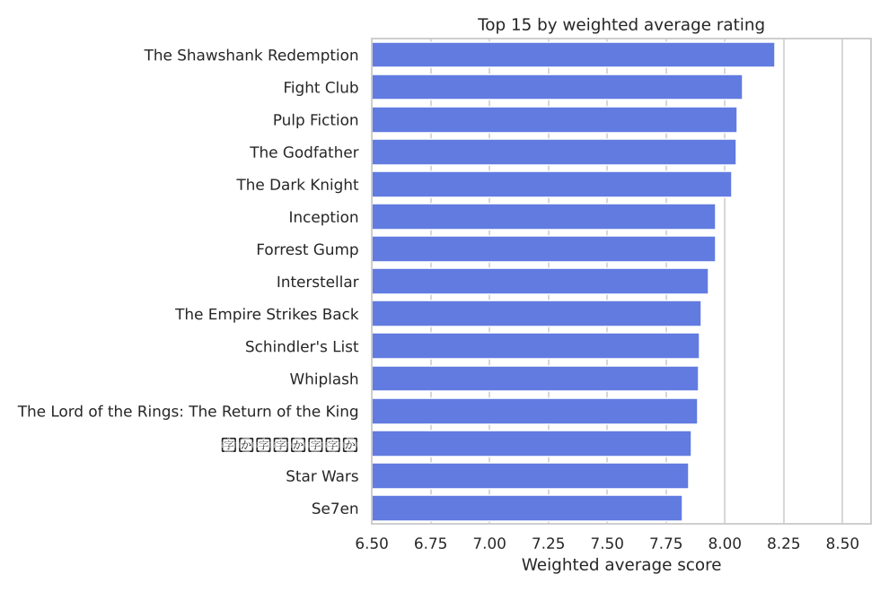
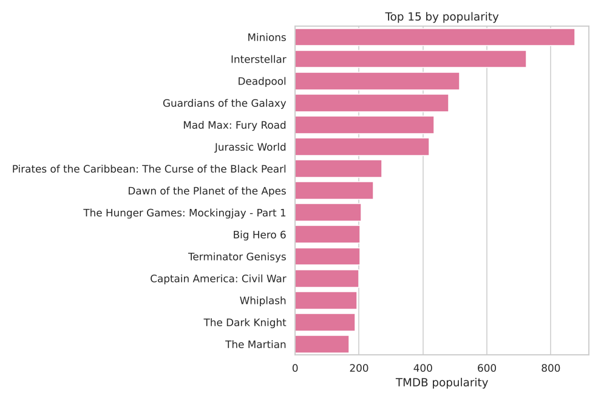
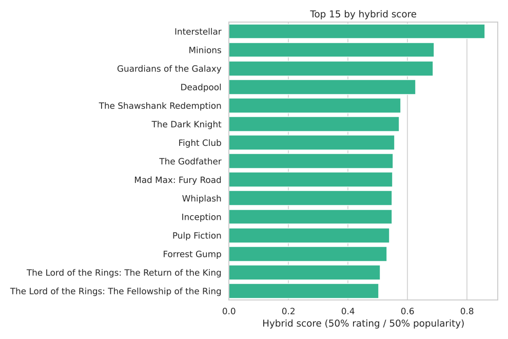

# 🎬 Movie Recommendation System

A content-based movie recommender built on the TMDB 5000 dataset, deployed as a
Streamlit app. Pick a film, get ten similar ones, ranked by the language of their
plot summaries.

**[▶ Try the live app](https://movie-recommender-rishabh.streamlit.app)**

---

## What it does

Each film's plot summary is turned into a TF-IDF vector over unigrams through
trigrams. Similarity between every pair of films is precomputed into a 481×481
matrix, and a recommendation is a lookup plus an `argsort` — so the app responds
instantly and needs no model at runtime, only NumPy and pandas.

```
tmdb_5000_movies.csv ─┐
                      ├─ merge on id ─ filter by vote_count ─ TF-IDF ─ sigmoid kernel ─ 481×481 matrix
tmdb_5000_credits.csv ┘      4,803          481 films          1,287        pairwise
                             films                            features     similarity
```

## Three recommenders, compared

The notebook builds three, in increasing sophistication. The first two are
baselines; the third is what the app serves.

**1. Weighted average rating** — the IMDB formula, which discounts films with few
votes by pulling their score toward the global mean:

```
score = (R·v + C·m) / (v + m)
```



**2. Popularity** — TMDB's own metric. Rewards attention and recency rather than
quality, which is visible in how different the ordering is:



**3. Hybrid** — both of the above min-max scaled to [0, 1] and combined 50/50:



**4. Content-based filtering** — the deployed model. Unlike the three above, it
is *personalised to a query* rather than a single global ranking.

## Design decisions worth explaining

**Why only 481 of 4,803 films?** `vote_count >= 1838`, the 90th percentile. The
vote distribution is extremely long-tailed, so a film with a 10.0 average off
three votes would otherwise dominate every ranking. The cost is real: the app
cannot recommend anything obscure.

**Why a sigmoid kernel rather than cosine similarity?** Cosine is the
conventional choice for TF-IDF, and this is the project's most interesting
wrinkle. `sigmoid_kernel` computes `tanh(γ⟨x,y⟩ + 1)`; TF-IDF dot products here
are small, so every pair lands in a band **0.00033 wide** around `tanh(1) =
0.7616`. The kernel is saturated.

That matters in two ways, both verified in the notebook:

- The *values* are meaningless as scores, so the app deliberately does not display them.
- The matrix must stay `float64` — casting to `float32` to halve the file reorders the top-10 for **26 of 481** films.

But the *ordering* is correct: `tanh` is monotonic, so ranking by this kernel is
equivalent to ranking by the dot product. Checked against cosine similarity, the
top-10 sets are **identical for 481/481 films**.

**Why no `tfidf.pkl` in the repo?** The vectoriser is needed to *build* the
similarity matrix, not to query it. Shipping it would add scikit-learn to the
app's runtime dependencies for no benefit. The app needs only Streamlit, pandas
and NumPy.

**Why version floors instead of pins in `requirements.txt`?** The app uses only
long-stable Streamlit APIs, and an over-tight pin that cannot resolve against the
host's Python is the most common cause of a failed cloud build.

## The bug this project taught me

The first working version was subtly wrong, and the way it was wrong is the most
useful thing here.

Filtering a DataFrame preserves the original index. So `fltr` held the original
TMDB row numbers — scattered from 0 to 4602 — while every matrix built from it was
only 481×481. The recommender looked up similarity rows by index label:

```python
indices = pd.Series(data=fltr.index, index=fltr.original_title)   # labels up to 4602
idx = indices[movie_title]
model_scores = list(enumerate(model[idx]))                        # into a 481-row matrix
```

Measured across all 481 films:

| Outcome | Films |
|---|---|
| Correct | **10** |
| Silently returned a *different* film's recommendations | **229** |
| Raised `IndexError` | **242** |

It survived because it was only ever tested on `"Avatar"` and `"John Carter"` —
original indices 0 and 2, inside the single window where the stale label happened
to equal row position. The first ten films of the dataset survived the vote filter
in order, so ten of 481 films were accidentally correct, and two of them were the
test cases.

The fix is one line, `fltr.reset_index(drop=True)`, so that row position and index
label are the same number. The lesson was not the line — it was that a spot check
on a familiar input is not a test. The notebook now asserts across the whole
catalogue:

```python
failures = []
for title in fltr["original_title"]:
    res = give_recc(title, sig)
    if len(res) != 10 or title in set(res):
        failures.append(title)
assert not failures        # 481 films tested, 0 failures
```

## Repository layout

```
├── app.py                              Streamlit app
├── pipeline.py                         rebuilds data/ and reports/ from the raw CSVs
├── requirements.txt
├── data/
│   ├── movie_titles.csv                481 films, in matrix row order
│   ├── sigmoid_kernel.npy              481×481 float64 similarity matrix (1.85 MB)
│   └── meta.json
├── notebooks/
│   └── movie_recommender.ipynb         the analysis: EDA, all three recommenders
└── reports/                            charts, regenerated by pipeline.py
```

## Running it locally

The raw TMDB files are not in the repo — they are 45 MB of regenerable source
data. Download [TMDB 5000 Movie Dataset](https://www.kaggle.com/datasets/tmdb/tmdb-movie-metadata)
into the project root if you want to rebuild the artifacts from scratch.

```bash
git clone https://github.com/rishabh-fx/movie-recommender.git
cd movie-recommender
pip install -r requirements.txt

streamlit run app.py          # the app runs off the committed artifacts

python pipeline.py            # optional: rebuild data/ and reports/ (needs the Kaggle CSVs + scikit-learn)
```

## Limitations

- **Plot summaries only.** Genres, cast and crew are parsed in the notebook and then unused — the single most obvious improvement would be to concatenate them into the text corpus.
- **No cold start.** A film outside the 481 cannot be queried or recommended.
- **O(n²) memory.** 481 films is 1.85 MB; the full 4,803 would be 184 MB, and a real catalogue would need approximate nearest neighbours instead of a dense matrix.

## Stack

Python · pandas · scikit-learn (TF-IDF, sigmoid kernel, MinMaxScaler) · NumPy ·
seaborn · Streamlit

Data: [TMDB 5000 Movie Dataset](https://www.kaggle.com/datasets/tmdb/tmdb-movie-metadata)
